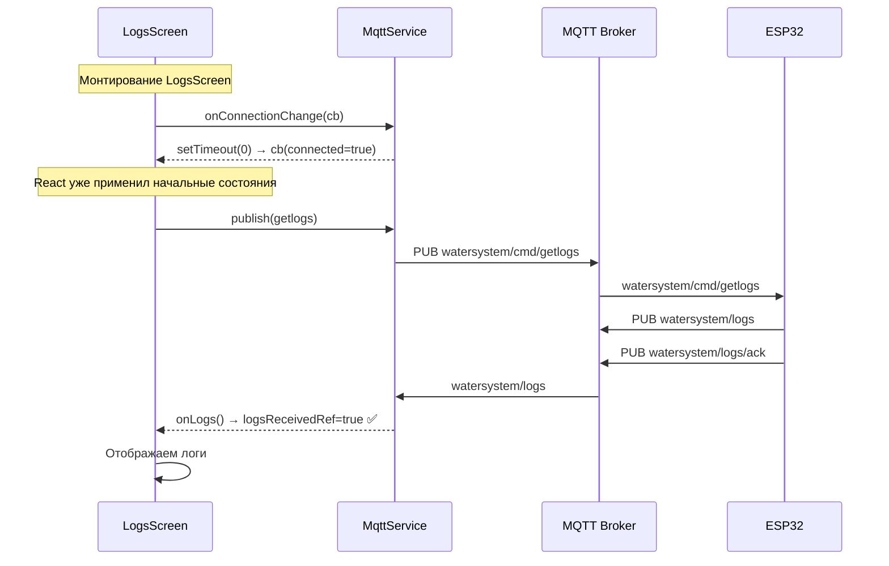

# План исправления отображения логов

## Корневая причина

Проблема возникла из-за комбинации двух изменений, сделанных в процессе исправления вертикального скроллинга:

### 1. Немедленный вызов `onConnectionChange` с текущим состоянием

В [`mobile/src/services/mqttService.ts:199-204`](../mobile/src/services/mqttService.ts:199) `onConnectionChange()` немедленно вызывает колбэк с текущим состоянием:

```typescript
onConnectionChange(cb) {
    this.connListeners.push(cb);
    cb(this._connected);  // ← НЕМЕДЛЕННЫЙ ВЫЗОВ при подписке!
    return () => { ... };
}
```

### 2. Сброс `logsReceived` в `onConnectionChange`

В [`mobile/src/screens/LogsScreen.tsx:88-123`](../mobile/src/screens/LogsScreen.tsx:88) при каждом подключении MQTT вызывается `setLogsReceived(false)`:

```typescript
const unsubConn = MqttService.onConnectionChange((connected) => {
    if (connected) {
        setError(null);
        setLoading(true);
        setLogsReceived(false);  // ← СБРАСЫВАЕТ флаг получения
        if (!logsReceived) {     // ← stale closure: всегда false
            MqttService.publish('getlogs', '1');
        }
    } else {
        setLogsReceived(false);
    }
});
```

### Сценарий отказа

1. Dashboard уже подключил MQTT
2. Пользователь переходит на LogsScreen
3. `useEffect` регистрирует `onConnectionChange` → немедленный вызов с `connected=true`
4. Внутри колбэка: `setLogsReceived(false)` — ставится в очередь React
5. Там же: `MqttService.publish('getlogs', '1')` — getlogs отправлен
6. Устройство отвечает, `onLogs` вызывает `setLogsReceived(true)` — ставится в очередь React
7. React применяет изменения: `setLogsReceived(false)` из шага 4 ПЕРЕЗАПИСЫВАЕТ `setLogsReceived(true)` из шага 6
8. Флаг `logsReceived` остаётся `false`
9. Таймаут 20 секунд срабатывает — пользователь видит ошибку

### Почему это связано с авто-скроллом?

Авто-скролл (`userScrolledUp`, `scrollToEnd`) сам по себе не ломает отображение логов. Проблема в том, что в процессе добавления авто-скролла был переписан `useEffect` в LogsScreen, и в него добавили:
- Немедленный вызов `onConnectionChange` (из mqttService.ts)
- Сброс `logsReceived` при каждом подключении
- Сброс `loading` и `error` при каждом подключении

## План исправления

### Изменение 1: `mobile/src/screens/LogsScreen.tsx`

**Проблема:** `logsReceived` в замыкании `useEffect` устаревает (stale closure), и `setLogsReceived(false)` перезаписывает `setLogsReceived(true)`.

**Решение:** Использовать `useRef` для `logsReceived` вместо `useState`, чтобы в замыкании всегда было актуальное значение.

```typescript
// ВМЕСТО:
const [logsReceived, setLogsReceived] = useState(false);

// ИСПОЛЬЗОВАТЬ:
const logsReceivedRef = useRef(false);
```

**Изменения в коде:**

1. Заменить `const [logsReceived, setLogsReceived] = useState(false);` на `const logsReceivedRef = useRef(false);`
2. В `onLogs`: `logsReceivedRef.current = true;` вместо `setLogsReceived(true);`
3. В `onConnectionChange(connected)`:
   - Убрать `setLogsReceived(false)` 
   - Использовать `logsReceivedRef.current = false;`
   - В условии `if (!logsReceivedRef.current)` вместо `if (!logsReceived)`
4. В `sendGetlogs`: `if (destroyed || logsReceivedRef.current) return;`
5. В `timeoutTimer`: `if (destroyed || logsReceivedRef.current) return;`
6. В `retry()`: `logsReceivedRef.current = false;` вместо `setLogsReceived(false);`
7. Удалить `logsReceived` из JSX (он нигде не используется в render)

### Изменение 2: `mobile/src/services/mqttService.ts`

**Проблема:** Немедленный вызов колбэка в `onConnectionChange()` приводит к тому, что LogsScreen получает `connected=true` ДО того, как React применил начальные состояния.

**Решение:** Убрать немедленный вызов или сделать его асинхронным через `setTimeout(..., 0)`.

```typescript
onConnectionChange(cb: ConnectionCallback): () => void {
    this.connListeners.push(cb);
    // Асинхронный вызов, чтобы дать подписчику возможность завершить регистрацию
    setTimeout(() => cb(this._connected), 0);
    return () => { ... };
}
```

### Изменение 3: `mobile/src/screens/LogsScreen.tsx` — упрощение `onConnectionChange`

**Проблема:** `onConnectionChange` при connected=true сбрасывает `loading` и `error`, что может конфликтовать с уже установленным состоянием.

**Решение:** Не сбрасывать `loading` и `error` при connected=true, если `logsReceivedRef.current === true` (логи уже получены).

```typescript
const unsubConn = MqttService.onConnectionChange((connected) => {
    if (destroyed) return;
    setMqttConnected(connected);
    if (connected) {
        setStatusMessage('MQTT подключён, запрос логов...');
        // Не сбрасываем error/loading, если логи уже получены
        if (!logsReceivedRef.current) {
            setError(null);
            setLoading(true);
            // Перезапускаем таймаут
            if (timeoutTimer) clearTimeout(timeoutTimer);
            timeoutTimer = setTimeout(() => { ... }, LOGS_TIMEOUT_MS);
            // Отправляем getlogs
            MqttService.publish('getlogs', '1');
        }
    } else {
        setStatusMessage('MQTT отключён');
        logsReceivedRef.current = false;
    }
});
```

### Изменение 4: `mobile/src/screens/LogsScreen.tsx` — удалить дублирующий таймаут

**Проблема:** В `useEffect` устанавливается два таймаута: один в `onConnectionChange` (строка 99) и один в основном теле (строка 141). Они оба сработают через 20 секунд.

**Решение:** Оставить только один таймаут — в основном теле `useEffect`. Убрать таймаут из `onConnectionChange`.

## Файлы для изменения

| Файл | Изменения |
|------|-----------|
| [`mobile/src/screens/LogsScreen.tsx`](../mobile/src/screens/LogsScreen.tsx) | Исправить stale closure через useRef, упростить onConnectionChange |
| [`mobile/src/services/mqttService.ts`](../mobile/src/services/mqttService.ts) | Сделать немедленный вызов onConnectionChange асинхронным |

## Диаграмма потока после исправления



## Проверка после исправления

1. **MQTT подключён заранее:** логи приходят в течение 1-2 секунд после входа на экран
2. **MQTT подключается после входа:** логи приходят после установки соединения
3. **Авто-скролл работает:** при добавлении новых событий скролл уходит вниз
4. **Пользователь скроллит вверх:** авто-скролл отключается (userScrolledUp)
5. **Reconnect MQTT:** getlogs отправляется повторно, логи приходят снова
6. **Таймаут:** показывается ошибка с кнопкой "Повторить"