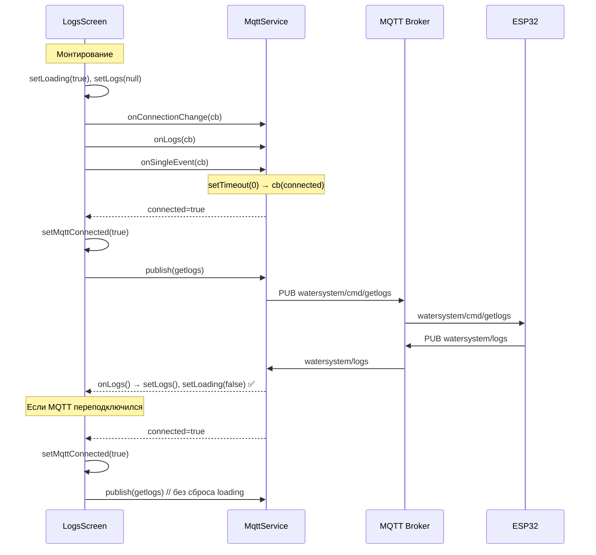

# План исправления отображения логов — v2

## Корневая причина (после анализа логов брокера и кода)

Из логов брокера wqtt.ru видно, что мобильные клиенты постоянно переподключаются:
```
16:01:03 Client mob_e1359a0b already connected, closing old connection.
16:01:24 Socket error on client mob_e1359a0b, disconnecting.
16:02:25 Client mob_e1359a0b has exceeded timeout, disconnecting.
16:04:42 Socket error on client mob_edad6be7, disconnecting.
```

### Проблема 1: Watchdog в mqttClient.ts

[`mobile/src/services/mqttClient.ts:330-348`](../mobile/src/services/mqttClient.ts:330) — watchdog сбрасывает PINGRESP и принудительно переподключается, если нет пакетов `keepalive` секунд (20 секунд). НО watchdog сбрасывается ТОЛЬКО при PINGRESP (строка 300), а не при любом пакете. Если PINGRESP не приходит из-за сетевых задержек — watchdog переподключает клиента.

**Эффект:** MQTT клиент переподключается каждые ~20-40 секунд, `onConnectionChange` вызывается с `connected=true`, LogsScreen сбрасывает состояние и отправляет новый `getlogs`, но логи не успевают прийти до следующего reconnect.

### Проблема 2: LogsScreen застревает в loading

В [`mobile/src/screens/LogsScreen.tsx:95-100`](../mobile/src/screens/LogsScreen.tsx:95) при каждом `onConnectionChange(connected=true)` вызывается `setLoading(true)`. Если watchdog переподключает клиента каждые 20 секунд, а таймаут 20 секунд — loading никогда не закончится.

### Проблема 3: Пустой экран при loading=false и logs=null

В [`mobile/src/screens/LogsScreen.tsx:248-255`](../mobile/src/screens/LogsScreen.tsx:248):
```tsx
{loading && !logs && ( ... )}  // спиннер
{logs !== null && ( ... )}     // логи
{error && ( ... )}             // ошибка
```

Если `loading=false`, `logs=null`, `error=null` — **ни один блок не рендерится**, экран пустой.

## План исправления

### Изменение 1: Отключить watchdog в mqttClient.ts

**Файл:** [`mobile/src/services/mqttClient.ts`](../mobile/src/services/mqttClient.ts)

**Что сделать:** Закомментировать или удалить watchdog-логику. Watchdog был добавлен для обнаружения "замороженных" WSS-соединений, но на практике он вызывает ложные срабатывания и делает соединение нестабильным.

**Изменения:**
1. Удалить `watchdogTimer`, `_watchdogClosing`, `_kickWatchdog()`, `_stopWatchdog()`
2. Удалить вызов `this._kickWatchdog()` из `_startPing()` (строка 314)
3. Удалить вызов `this._stopWatchdog()` из `_stopPing()` (строка 322)
4. Удалить вызов `this._stopWatchdog()` из `onclose` (строка 191)
5. Удалить `case 13: // PINGRESP` — больше не нужно сбрасывать watchdog

### Изменение 2: Упростить LogsScreen.tsx — убрать setLoading в onConnectionChange

**Файл:** [`mobile/src/screens/LogsScreen.tsx`](../mobile/src/screens/LogsScreen.tsx)

**Что сделать:** В `onConnectionChange` при `connected=true` не вызывать `setLoading(true)`. Loading устанавливается только один раз при монтировании `useEffect`. Если MQTT переподключился — просто отправить `getlogs` без сброса loading.

**Изменения:**
```typescript
const unsubConn = MqttService.onConnectionChange((connected) => {
    if (destroyed) return;
    setMqttConnected(connected);
    if (connected) {
        setStatusMessage('MQTT подключён, запрос логов...');
        // Не сбрасываем loading — он уже установлен при монтировании.
        // Просто отправляем getlogs, если логи ещё не получены.
        if (!logsReceivedRef.current) {
            MqttService.publish('getlogs', '1');
        }
    } else {
        setStatusMessage('MQTT отключён');
        logsReceivedRef.current = false;
    }
});
```

### Изменение 3: Добавить fallback-рендеринг для пустого экрана

**Файл:** [`mobile/src/screens/LogsScreen.tsx`](../mobile/src/screens/LogsScreen.tsx)

**Что сделать:** Добавить блок, который показывается, когда `loading=false`, `logs=null`, `error=null` — чтобы экран не был пустым.

```tsx
{!loading && !logs && !error && (
    <Card style={[styles.card, styles.infoCard]}>
        <Card.Content>
            <Text style={styles.infoText}>
                Ожидание данных от устройства...
            </Text>
            <Button mode="contained" onPress={retry} icon="refresh" style={styles.retryButton}>
                Запросить логи
            </Button>
        </Card.Content>
    </Card>
)}
```

### Изменение 4: Увеличить таймаут и уменьшить количество retry

**Файл:** [`mobile/src/screens/LogsScreen.tsx`](../mobile/src/screens/LogsScreen.tsx)

**Что сделать:** Увеличить таймаут с 20 до 30 секунд, уменьшить retry с 4 до 2.

```typescript
const LOGS_TIMEOUT_MS = 30000;        // 30 секунд
const GETLOGS_RETRY_MS = 5000;        // повтор каждые 5 секунд
const GETLOGS_MAX_RETRIES = 2;        // максимум 2 попытки
```

## Файлы для изменения

| Файл | Изменения |
|------|-----------|
| [`mobile/src/services/mqttClient.ts`](../mobile/src/services/mqttClient.ts) | Отключить watchdog |
| [`mobile/src/screens/LogsScreen.tsx`](../mobile/src/screens/LogsScreen.tsx) | Убрать setLoading в onConnectionChange, добавить fallback, увеличить таймауты |

## Диаграмма потока после исправления



## Проверка

1. Установить APK на телефон
2. Открыть экран логов — должен показаться спиннер "Загрузка логов..."
3. В течение 30 секунд должны появиться логи
4. Если логи не пришли — показывается кнопка "Повторить"
5. При переподключении MQTT — getlogs отправляется повторно, но спиннер не моргает