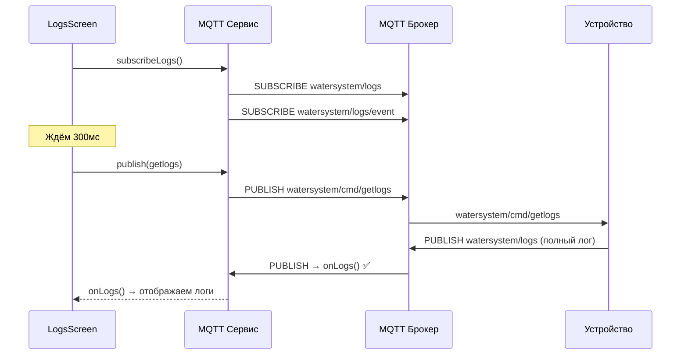

# План исправления загрузки логов (v4)

## Найденная проблема: Race condition в MQTT подписке

**Корневая причина:** В [`mqttService.ts:102-108`](../mobile/src/services/mqttService.ts:102) `_notifyConn(connected)` вызывается **ДО** `subscribe()`:

```typescript
this.client.onConnChange((connected) => {
  this._connected = connected;
  this._notifyConn(connected);  // ← 1. Сначала оповещаем слушателей
  if (connected) {
    this.client!.subscribe([...]);  // ← 2. ПОТОМ подписываемся на топики
    resolve();
  }
});
```

Когда LogsScreen получает `connected=true`, он сразу отправляет `getlogs`. Но подписка на `watersystem/logs` ещё не отправлена на брокер. Устройство получает `getlogs`, публикует логи, но приложение их не получает — подписка ещё не активна.

## Исправления

### 1. [`mobile/src/services/mqttService.ts`](../mobile/src/services/mqttService.ts)

Добавить метод `subscribeLogs()` для явной подписки на логи:

```typescript
/** Subscribe to log topics (watersystem/logs and watersystem/logs/event). */
subscribeLogs(): void {
  if (this.client && this._connected) {
    this.client.subscribe([TOPIC_LOGS, TOPIC_LOG_EVENT]);
  }
}
```

### 2. [`mobile/src/screens/LogsScreen.tsx`](../mobile/src/screens/LogsScreen.tsx)

Изменить логику при входе на экран:

```typescript
// При монтировании:
// 1. Явно подписаться на watersystem/logs и watersystem/logs/event
MqttService.subscribeLogs();

// 2. Подождать 300мс, чтобы подписка гарантированно ушла на брокер
setTimeout(() => {
  MqttService.publish('getlogs', '1');
}, 300);
```

### 3. [`mobile/src/screens/DashboardScreen.tsx`](../mobile/src/screens/DashboardScreen.tsx)

Уже исправлено — `MqttService.disconnect()` убран.

## Схема работы после исправления



## Файлы для изменения

| Файл | Изменение |
|------|-----------|
| [`mobile/src/services/mqttService.ts`](../mobile/src/services/mqttService.ts) | Добавить метод `subscribeLogs()` |
| [`mobile/src/screens/LogsScreen.tsx`](../mobile/src/screens/LogsScreen.tsx) | Вызывать `subscribeLogs()` перед `getlogs`, добавить задержку 300мс |
| [`mobile/src/screens/DashboardScreen.tsx`](../mobile/src/screens/DashboardScreen.tsx) | Уже исправлено |