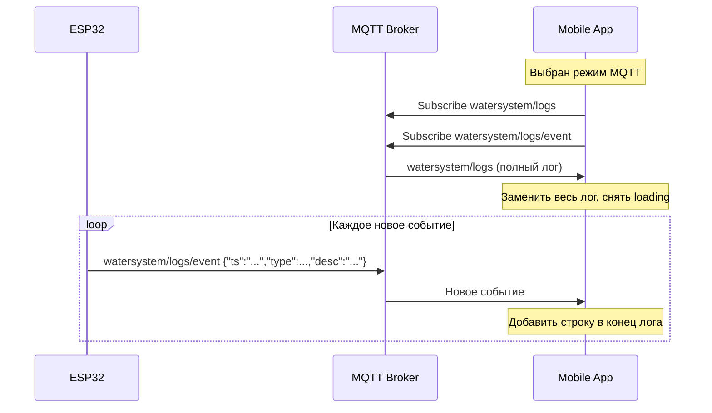

# План исправления трёх проблем + потоковая загрузка логов

## Проблема #1: Индикатор "Подключение к MQTT" крутится бесконечно при уже установленном соединении

### Корневая причина
В [`mobile/src/screens/LogsScreen.tsx`](mobile/src/screens/LogsScreen.tsx:23) при выборе режима `mqtt_direct`:
1. Вызывается `MqttService.connect()` (строка 45)
2. В [`mobile/src/services/mqttService.ts`](mobile/src/services/mqttService.ts:79-80) метод `connect()` проверяет: если `_connected === true`, он сразу возвращает `Promise.resolve()` **без вызова колбэка `onConnectionChange`**
3. Колбэк `onConnectionChange` (строка 33-38 LogsScreen) сбрасывает `loading` только при вызове
4. В итоге: `loading` остаётся `true`, пользователь видит спиннер и надпись "Подключение к MQTT..." бесконечно

### Исправление
В [`mobile/src/screens/LogsScreen.tsx`](mobile/src/screens/LogsScreen.tsx:45) после `MqttService.connect()` добавить проверку `MqttService.connected`:

```typescript
MqttService.connect().then(() => {
    // Если соединение уже было установлено до подписки onConnectionChange,
    // сбрасываем loading вручную
    if (MqttService.connected) {
        setLoading(false);
        setMqttConnected(true);
    }
}).catch((err) => {
    // существующий обработчик ошибок
});
```

---

## Проблема #2: Дублирующийся пункт меню "БД"

### Корневая причина
В [`mobile/src/screens/LogsScreen.tsx`](mobile/src/screens/LogsScreen.tsx:238-248) есть 4 режима загрузки логов:
- `mqtt_direct` (MQTT напрямую) — получает логи через MQTT WebSocket в реальном времени
- `mqtt_db` (БД) — получает логи из БД сервера (тоже через MQTT, но сохранённые)
- `direct_events` (RAM) — прямой HTTP-запрос к ESP32
- `direct_sd` (SD) — прямой HTTP-запрос к ESP32 за файлом с SD

Пункт **"БД"** (`mqtt_db`) функционально дублирует **"MQTT"** (`mqtt_direct`): оба получают логи, опубликованные устройством через MQTT. Разница лишь в том, что `mqtt_direct` показывает логи в реальном времени, а `mqtt_db` — сохранённые в БД сервера. Для пользователя это избыточно.

### Исправление
Удалить режим `mqtt_db` из [`mobile/src/screens/LogsScreen.tsx`](mobile/src/screens/LogsScreen.tsx):
1. Удалить тип `'mqtt_db'` из union-типа `LogSource` (строка 7)
2. Удалить кнопку `{ value: 'mqtt_db', label: 'БД' }` из `SegmentedButtons` (строка 243)
3. Удалить блок кода `if (logSource === 'mqtt_db')` из функции `fetchLogs` (строки 103-139)
4. Удалить соответствующее описание из текста (строка 203)

---

## Проблема #3: Ошибка 500 при загрузке логов из RAM/SD

### Корневая причина
Ошибка 500 возникает при прямом HTTP-запросе к ESP32 из мобильного приложения.

**Для RAM** (`/logs.txt`):
В [`src/event_logging.cpp`](src/event_logging.cpp:570-595) функция `exportEventsAsText()` конкатенирует строки в цикле:
```cpp
String out = "";
for (...) {
    out += String(buf);  // конкатенация до 200 раз
}
```
На ESP32 это приводит к фрагментации heap. Если логов много (100-200 записей), строка может занимать 10-20 КБ, и конкатенация через `+=` вызывает множественные переаллокации, что может привести к ошибке памяти и 500.

**Для SD** (`/api/sd_file?name=/events.log`):
В [`src/web_server.cpp`](src/web_server.cpp:1358-1380) endpoint пытается отправить файл с SD-карты. Если файл большой или повреждён, `request->send(SD, path)` может вернуть 500.

### Исправление

**Для RAM** — оптимизировать `exportEventsAsText()` в [`src/event_logging.cpp`](src/event_logging.cpp:570):
- Использовать предварительное резервирование памяти (`reserve()`)
- Или использовать `AsyncResponseStream` для потоковой отправки (как в `/legacy`)

**Для SD** — в [`src/web_server.cpp`](src/web_server.cpp:1358):
- Добавить проверку размера файла перед отправкой
- Добавить обработку ошибок при отправке

**Для мобильного приложения** — в [`mobile/src/services/api.ts`](mobile/src/services/api.ts:65-94):
- Добавить retry-логику при ошибках 500
- Улучшить обработку ошибок в [`mobile/src/screens/LogsScreen.tsx`](mobile/src/screens/LogsScreen.tsx:159-191) для случая, когда `err.response` отсутствует (прямой `fetch`, не axios)

---

## Проблема #4 (новая): Потоковая загрузка логов по одному событию

### Суть предложения
Сейчас логи публикуются раз в 60 секунд одним большим блоком (до 2000 байт) в топик `watersystem/logs`. Мобильное приложение каждый раз **заменяет** весь лог новым содержимым. Предлагается добавить публикацию каждого нового события по мере его возникновения в отдельный топик, чтобы приложение могло **добавлять** новые строки к уже загруженным.

### Что меняется на ESP32

#### 1. Новый топик `watersystem/logs/event`
В [`src/vqtt.cpp`](src/vqtt.cpp) добавить функцию `vqtt_publishSingleEvent()`:

```cpp
void vqtt_publishSingleEvent(const EventLog& event) {
    if (!activeMqtt || !activeMqtt->connected()) return;
    
    char desc[80];
    getEventTypeLong(event.level, event.eventType, event.eventParam, desc, sizeof(desc));
    
    DynamicJsonDocument doc(256);
    char ts[24];
    snprintf(ts, sizeof(ts), "%02d.%02d.%04d %02d:%02d:%02d",
             event.day, event.month, event.year, event.hour, event.minute, 0);
    doc["ts"] = ts;
    doc["type"] = event.eventType;
    doc["level"] = (int)event.level;
    doc["desc"] = desc;
    
    String out;
    serializeJson(doc, out);
    String topic = mqttTopicBase + "/logs/event";
    activeMqtt->publish(topic.c_str(), out.c_str());
}
```

#### 2. Вызов из `saveEventLog()`
В [`src/event_logging.cpp`](src/event_logging.cpp:115) после сохранения события в RAM и на SD, добавить вызов `vqtt_publishSingleEvent(entry)`.

#### 3. Объявление в заголовочном файле
В [`include/vqtt.h`](include/vqtt.h) добавить объявление `void vqtt_publishSingleEvent(const EventLog& event);`

### Что меняется в мобильном приложении

#### 1. [`mobile/src/services/mqttService.ts`](mobile/src/services/mqttService.ts)

Добавить:
- Константу `TOPIC_LOG_EVENT = 'watersystem/logs/event'`
- Подписку на этот топик в `connect()` (рядом с существующими подписками)
- Новый тип колбэка `SingleEventCallback = (event: { ts: string, type: number, level: number, desc: string }) => void`
- Метод `onSingleEvent(cb)` — регистрирует колбэк на одиночные события
- В `onMessage()` добавить обработку `topic === TOPIC_LOG_EVENT`

#### 2. [`mobile/src/screens/LogsScreen.tsx`](mobile/src/screens/LogsScreen.tsx)

Изменить логику для режима `mqtt_direct`:
1. При первом подключении получить полный лог через существующий `onLogs` (заменяет весь лог)
2. Подписаться на `onSingleEvent` — каждое новое событие **добавлять** в конец существующего текста
3. Индикатор загрузки (`loading`) показывать только до получения первого полного лога
4. После получения полного лога — снять индикатор и перейти в режим "добавления новых строк"

### Схема работы



### Преимущества
1. **Мгновенное отображение** — новые события появляются сразу, а не раз в 60 секунд
2. **Низкая нагрузка** — каждое сообщение ~100 байт вместо 2000 байт
3. **Нет потери данных** — при переподключении полный лог всё ещё доступен
4. **Решает проблему #1** — индикатор загрузки горит только до получения первого полного лога

---

## Итоговый список задач

| # | Файл | Что сделать |
|---|------|-------------|
| 1 | `mobile/src/screens/LogsScreen.tsx` | После `MqttService.connect()` добавить проверку `MqttService.connected` для сброса `loading` |
| 2 | `mobile/src/screens/LogsScreen.tsx` | Удалить дублирующийся режим `mqtt_db` (БД) |
| 3 | `src/event_logging.cpp` | Оптимизировать `exportEventsAsText()` — добавить `reserve()` для предотвращения фрагментации памяти |
| 4 | `src/web_server.cpp` | Добавить обработку ошибок в endpoint `/api/sd_file` |
| 5 | `mobile/src/services/api.ts` | Улучшить обработку ошибок в `fetchDeviceLogsDirect` |
| 6 | `src/vqtt.cpp` | Добавить функцию `vqtt_publishSingleEvent()` для публикации каждого нового события |
| 7 | `include/vqtt.h` | Добавить объявление `vqtt_publishSingleEvent()` |
| 8 | `src/event_logging.cpp` | В `saveEventLog()` добавить вызов `vqtt_publishSingleEvent()` |
| 9 | `mobile/src/services/mqttService.ts` | Добавить подписку на `watersystem/logs/event`, новый колбэк `onSingleEvent` |
| 10 | `mobile/src/screens/LogsScreen.tsx` | В режиме MQTT: получать полный лог, затем добавлять новые события по одному |