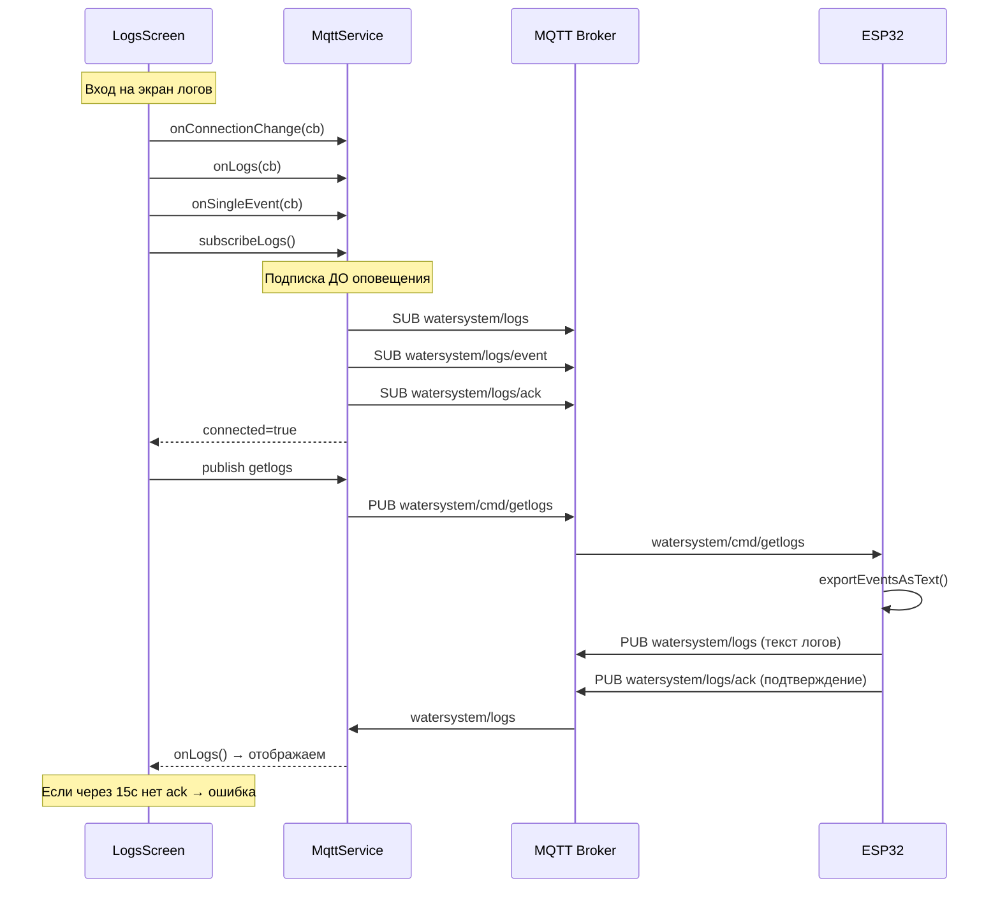

# План полной перезаписи системы вывода логов

## Корневая проблема

Логи НЕ отображаются в мобильном приложении. После анализа всего стека (ESP32 → MQTT → Mobile App) выявлены критические проблемы:

### 1. Race condition в MQTT Service (mqttService.ts:102-108)
Подписка на топики происходит **ПОСЛЕ** оповещения слушателей. LogsScreen получает `connected=true`, отправляет `getlogs`, но подписка на `watersystem/logs` ещё не активна.

### 2. Нет гарантии доставки getlogs
LogsScreen отправляет `getlogs` с retry, но если MQTT не подключён — команда не отправляется. Приходится ждать следующего retry через 3 секунды.

### 3. Нет ответа на getlogs от ESP32
ESP32 получает `getlogs` и вызывает `vqtt_publishLogs()`, но:
- Если MQTT отключился между получением команды и публикацией — публикация молча скипается
- Нет подтверждения, что логи опубликованы
- Нет повторной попытки публикации

### 4. Нет диагностики
Пользователь не видит, на каком этапе проблема: MQTT не подключён, подписка не активна, устройство не ответило, или логи пусты.

### 5. Сложная логика с HTTP fallback
HTTP fallback редко работает (требует локальной сети), но усложняет код и отладку.

---

## Новая архитектура

### Принципы:
1. **Только MQTT** — единственный канал получения логов (HTTP fallback удалён)
2. **Подписка до оповещения** — гарантия, что подписка активна до отправки getlogs
3. **Подтверждение getlogs** — ESP32 публикует подтверждение в топик `watersystem/logs/ack`
4. **Диагностика** — показывать статус каждого этапа
5. **Простота** — минимум кода, максимум надёжности

### Поток данных:



---

## Детальный план изменений

### Файл 1: `mobile/src/services/mqttService.ts` — ПОЛНАЯ ПЕРЕЗАПИСЬ

**Проблемы:**
1. Race condition: подписка после оповещения (строки 102-108)
2. Нет подписки на `watersystem/logs/ack`
3. `subscribeLogs()` дублирует подписку из `connect()`
4. Нет метода для отправки getlogs с подтверждением

**Новая реализация:**

```typescript
// Константы
const TOPIC_TELEMETRY = 'watersystem/telemetry';
const TOPIC_STATUS    = 'watersystem/status';
const TOPIC_LOGS      = 'watersystem/logs';
const TOPIC_LOG_EVENT = 'watersystem/logs/event';
const TOPIC_LOG_ACK   = 'watersystem/logs/ack';  // НОВЫЙ топик
const TOPIC_CMD_BASE  = 'watersystem/cmd';

// В connect():
this.client.onConnChange((connected) => {
  this._connected = connected;
  if (connected) {
    // 1. Сначала подписываемся на ВСЕ топики
    this.client!.subscribe([
      TOPIC_TELEMETRY, 
      TOPIC_STATUS, 
      TOPIC_LOGS, 
      TOPIC_LOG_EVENT,
      TOPIC_LOG_ACK  // НОВЫЙ топик
    ]);
    // 2. Потом оповещаем слушателей
    this._notifyConn(true);
    resolve();
  } else {
    this._notifyConn(false);
  }
});

// В onMessage():
} else if (topic === TOPIC_LOG_ACK) {
  // Просто оповещаем слушателей, что устройство подтвердило получение getlogs
  this.logAckListeners.forEach(cb => cb());
}

// НОВЫЙ метод: отправить getlogs и ждать подтверждения
sendGetlogsWithAck(timeoutMs: number): Promise<boolean> {
  return new Promise((resolve) => {
    if (!this._connected) {
      resolve(false);
      return;
    }
    
    const timeout = setTimeout(() => {
      resolve(false);
    }, timeoutMs);
    
    const unsub = this.onLogAck(() => {
      clearTimeout(timeout);
      resolve(true);
    });
    
    this.publish('getlogs', '1');
  });
}
```

**Изменения:**
1. Переставить порядок: подписка → оповещение
2. Добавить подписку на `watersystem/logs/ack`
3. Добавить `logAckListeners` и `onLogAck()`
4. Добавить `sendGetlogsWithAck()` — отправка getlogs с ожиданием подтверждения
5. Удалить `subscribeLogs()` — больше не нужен, подписка происходит в `connect()`

---

### Файл 2: `mobile/src/screens/LogsScreen.tsx` — ПОЛНАЯ ПЕРЕЗАПИСЬ

**Проблемы:**
1. Сложная логика с retry, HTTP fallback, таймерами
2. Race condition: getlogs отправляется до подписки
3. Нет диагностики: пользователь не видит, что происходит
4. HTTP fallback усложняет код и редко работает

**Новая реализация:**

```typescript
// Константы
const LOGS_TIMEOUT_MS = 20000;       // 20 секунд на получение логов
const GETLOGS_RETRY_MS = 3000;       // повтор getlogs каждые 3 секунды
const GETLOGS_MAX_RETRIES = 4;       // максимум 4 попытки

// Состояние
const [logs, setLogs] = useState<string | null>(null);
const [loading, setLoading] = useState(true);
const [error, setError] = useState<string | null>(null);
const [mqttConnected, setMqttConnected] = useState(false);
const [statusMessage, setStatusMessage] = useState(''); // НОВОЕ: диагностика
const [logsReceived, setLogsReceived] = useState(false); // НОВОЕ: флаг получения

// Логика:
useEffect(() => {
  // Сброс состояния
  setLoading(true);
  setError(null);
  setLogs(null);
  setLogsReceived(false);
  setStatusMessage('Подключение к MQTT...');
  
  let retryTimer: ReturnType<typeof setTimeout> | null = null;
  let timeoutTimer: ReturnType<typeof setTimeout> | null = null;
  let attempts = 0;
  let destroyed = false;
  
  // Обработчик получения полного лога
  const unsubLogs = MqttService.onLogs((logsText) => {
    if (destroyed) return;
    setLogsReceived(true);
    setLogs(logsText);
    setError(null);
    setLoading(false);
    setStatusMessage('Логи получены');
    if (retryTimer) clearTimeout(retryTimer);
    if (timeoutTimer) clearTimeout(timeoutTimer);
  });
  
  // Обработчик новых событий (стриминг)
  const unsubEvent = MqttService.onSingleEvent((event) => {
    if (destroyed) return;
    setLogs((prev) => {
      const line = `${event.ts} - ${event.desc}\n`;
      return prev ? prev + line : line;
    });
  });
  
  // Обработчик изменения соединения
  const unsubConn = MqttService.onConnectionChange((connected) => {
    if (destroyed) return;
    setMqttConnected(connected);
    if (connected) {
      setStatusMessage('MQTT подключён, запрос логов...');
      // Отправляем getlogs при каждом подключении
      MqttService.publish('getlogs', '1');
    } else {
      setStatusMessage('MQTT отключён');
    }
  });
  
  // Функция повторной отправки getlogs
  const sendGetlogs = () => {
    if (destroyed || logsReceived) return;
    attempts++;
    setStatusMessage(`Запрос логов (попытка ${attempts}/${GETLOGS_MAX_RETRIES})...`);
    if (MqttService.connected) {
      MqttService.publish('getlogs', '1');
    }
    if (attempts < GETLOGS_MAX_RETRIES) {
      retryTimer = setTimeout(sendGetlogs, GETLOGS_RETRY_MS);
    }
  };
  
  // Таймаут
  timeoutTimer = setTimeout(() => {
    if (destroyed || logsReceived) return;
    setLoading(false);
    setError(
      'Не удалось загрузить логи.\n\n' +
      'Проверьте:\n' +
      '• Устройство должно быть включено и подключено к MQTT\n' +
      '• Настройки MQTT в разделе Settings (шестерёнка)\n' +
      '• На устройстве может быть включён фильтр логов (меню Engineer → Log Filter)'
    );
    setStatusMessage('Таймаут');
  }, LOGS_TIMEOUT_MS);
  
  // Если MQTT уже подключён — сразу отправляем getlogs
  if (MqttService.connected) {
    setStatusMessage('MQTT подключён, запрос логов...');
    MqttService.publish('getlogs', '1');
  }
  
  // Запасной вариант с retry
  setTimeout(sendGetlogs, 1000);
  
  return () => {
    destroyed = true;
    if (retryTimer) clearTimeout(retryTimer);
    if (timeoutTimer) clearTimeout(timeoutTimer);
    unsubLogs();
    unsubEvent();
    unsubConn();
  };
}, []);
```

**Изменения:**
1. Удалён HTTP fallback (весь блок с `fetch()`)
2. Удалён `subscribeLogs()` — подписка происходит в `connect()`
3. Добавлен `statusMessage` для диагностики
4. Добавлен `logsReceived` для предотвращения повторной обработки
5. Упрощена логика retry
6. Увеличен таймаут до 20 секунд
7. Удалён `deviceIp` из зависимостей (больше не нужен для HTTP)

---

### Файл 3: `src/vqtt.cpp` — публикация логов по getlogs

**Проблемы:**
1. `vqtt_publishLogs()` молча скипается, если MQTT не подключён
2. Нет подтверждения, что логи опубликованы
3. Нет повторной попытки публикации

**Изменения:**

```cpp
// НОВАЯ функция: публикация с подтверждением
void vqtt_publishLogsWithAck() {
  if (!activeMqtt || !activeMqtt->connected()) {
    Serial.println("[VQTT] Cannot publish logs: MQTT not connected");
    return;
  }
  
  // Публикуем логи
  vqtt_publishLogs();
  
  // Публикуем подтверждение
  String ackTopic = mqttTopicBase + "/logs/ack";
  String ackPayload = "ok";
  activeMqtt->publish(ackTopic.c_str(), ackPayload.c_str());
  Serial.printf("[VQTT] Published log ack to %s\n", ackTopic.c_str());
}

// В обработчике getlogs (строка 161-164):
if (cmd == "getlogs") {
  Serial.println("[VQTT] Forced log publish via getlogs command");
  vqtt_publishLogsWithAck();  // ← используем новую функцию
  return;
}
```

**Изменения:**
1. Добавлена `vqtt_publishLogsWithAck()` — публикует логи + подтверждение
2. В обработчике `getlogs` вызывать `vqtt_publishLogsWithAck()` вместо `vqtt_publishLogs()`
3. Топик подтверждения: `watersystem/logs/ack`

---

### Файл 4: `src/event_logging.cpp` — улучшение формата логов

**Проблемы:**
1. `exportEventsAsText()` возвращает `"(no events)\n"` когда нет событий — это сбивает с толку
2. Нет информации о том, сколько всего событий в буфере
3. Нет информации о фильтре логов

**Изменения:**

```cpp
// В exportEventsAsText() — добавить заголовок с мета-информацией
String exportEventsAsText() {
  extern EventLog eventLogs[200];
  extern uint8_t eventLogIndex;
  int total = getEventLogCount();
  
  String out;
  out.reserve(total * 160 + 64);
  
  // Добавляем заголовок с мета-информацией
  char header[64];
  int headerLen = snprintf(header, sizeof(header), 
    "# Events: %d | Buffer: %d/200\n", total, total);
  out.concat(header, headerLen);
  
  // Если нет событий — возвращаем только заголовок
  if (total == 0) {
    out.concat("(no events)\n");
    return out;
  }
  
  int start = (total < 200) ? 0 : eventLogIndex;
  
  for (int n = 0; n < total; ++n) {
    int idx = (start + n) % 200;
    EventLog &e = eventLogs[idx];
    if (e.eventType == 0) continue;
    char desc[80];
    getEventTypeLong(e.level, e.eventType, e.eventParam, desc, sizeof(desc));
    char buf[200];
    int len = snprintf(buf, sizeof(buf), 
      "%02d.%02d.%04d %02d:%02d - %s\n",
      e.day, e.month, e.year, e.hour, e.minute, desc);
    out.concat(buf, len);
  }
  
  return out;
}
```

**Изменения:**
1. Добавить заголовок с количеством событий
2. Упростить формат строки (убрать `type:XX param:XX lvl:X` — они не нужны пользователю)
3. Если нет событий — возвращать `"(no events)\n"` с заголовком

---

### Файл 5: `src/web_server.cpp` — улучшение /logs.txt

**Проблемы:**
1. `/logs.txt` использует `exportEventsAsText()` — может вызвать ошибку 500 при нехватке памяти
2. Нет CORS-заголовков

**Изменения:**

```cpp
// Заменить строки 1449-1456:
server.on("/logs.txt", HTTP_GET, [](AsyncWebServerRequest* request) {
  IPAddress clientIP = request->client()->remoteIP();
  Serial.printf("[Web] GET /logs.txt from %s\n", clientIP.toString().c_str());
  
  // Используем стриминг вместо String для предотвращения ошибки 500
  AsyncResponseStream *response = request->beginResponseStream("text/plain; charset=utf-8");
  if (!response) {
    request->send(500, "text/plain", "Internal Server Error");
    return;
  }
  response->addHeader("Access-Control-Allow-Origin", "*");
  streamEventsAsText(*response);
  request->send(response);
});
```

**Изменения:**
1. Использовать `streamEventsAsText()` вместо `exportEventsAsText()` для предотвращения ошибки 500
2. Добавить CORS-заголовок

---

## Сводка изменений по файлам

| Файл | Тип изменений | Описание |
|------|---------------|----------|
| `mobile/src/services/mqttService.ts` | Перезапись | Исправить race condition, добавить ack-топик, убрать subscribeLogs() |
| `mobile/src/screens/LogsScreen.tsx` | Перезапись | Упростить логику, убрать HTTP fallback, добавить диагностику |
| `src/vqtt.cpp` | Модификация | Добавить публикацию подтверждения getlogs |
| `src/event_logging.cpp` | Модификация | Улучшить формат логов, добавить заголовок |
| `src/web_server.cpp` | Модификация | Использовать стриминг для /logs.txt |

---

## Порядок выполнения

1. **Сначала ESP32 (vqtt.cpp + event_logging.cpp + web_server.cpp)** — чтобы устройство начало публиковать подтверждения и улучшенные логи
2. **Потом мобильное приложение (mqttService.ts + LogsScreen.tsx)** — чтобы приложение могло использовать новые возможности

---

## Проверка после изменений

1. **MQTT подключён:** логи должны прийти в течение 1-2 секунд после входа на экран
2. **MQTT не подключён:** показывать статус "MQTT не подключён" и понятную ошибку
3. **Нет событий:** показывать "(нет событий)" без ошибки
4. **Новые события:** добавляются в реальном времени
5. **Переподключение MQTT:** логи приходят повторно
6. **Таймаут:** показывать ошибку с кнопкой "Повторить"