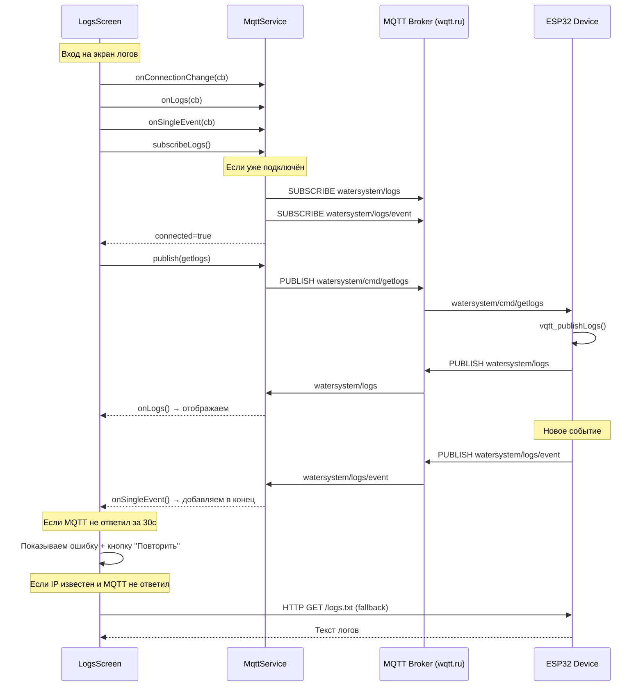

# Полный анализ и план исправления экрана логов

## 1. Текущая архитектура (как есть)

### 1.1. ESP32 (firmware) — публикация логов

**Публикация полного лога** (`vqtt_publishLogs()` в `src/vqtt.cpp:676-705`):
- Вызывается при подключении к MQTT брокеру (`src/vqtt.cpp:432-433`)
- Вызывается по команде `getlogs` (`src/vqtt.cpp:161-164`)
- Вызывается раз в 60 секунд по таймеру (`src/vqtt.cpp:39-40`)
- Берёт последние ~20 записей из RAM-буфера через `exportEventsAsText()`
- Обрезает до 2000 байт (MQTT лимит)
- Публикует в топик `watersystem/logs`

**Публикация одиночных событий** (`vqtt_publishSingleEvent()` в `src/vqtt.cpp:709-733`):
- Вызывается из `saveEventLog()` при каждом новом событии (`src/event_logging.cpp:196-198`)
- Публикует JSON в топик `watersystem/logs/event`
- Формат: `{"ts": "DD.MM.YYYY HH:MM:SS", "type": N, "level": N, "desc": "..."}`

**HTTP endpoint `/logs.txt`** (`src/web_server.cpp:1449-1456`):
- Вызывает `exportEventsAsText()` — формирует String из RAM-буфера
- Отдаёт как `text/plain`
- Доступен только в локальной сети (прямой HTTP к ESP32)

### 1.2. Мобильное приложение — получение логов

**MQTT Service** (`mobile/src/services/mqttService.ts`):
- Подключается к wqtt.ru через WebSocket Secure (WSS)
- Подписывается на топики: `watersystem/telemetry`, `watersystem/status`, `watersystem/logs`, `watersystem/logs/event`
- `onLogs(cb)` — подписка на полный лог
- `onSingleEvent(cb)` — подписка на одиночные события
- `publish(target, payload)` — публикует в `watersystem/cmd/{target}`

**LogsScreen** (`mobile/src/screens/LogsScreen.tsx`):
- При монтировании:
  1. Подписывается на `onConnectionChange` — отслеживает статус MQTT
  2. Подписывается на `onLogs` — получает полный лог
  3. Подписывается на `onSingleEvent` — получает новые события
  4. Вызывает `MqttService.subscribeLogs()` — явная подписка на лог-топики
  5. Отправляет `getlogs` с повторными попытками (до 4 раз, каждые 3 сек)
  6. Через 2 секунды запускает HTTP fallback: `fetch(http://{deviceIp}/logs.txt)`
- Общий таймаут: 15 секунд

**HTTP API** (`mobile/src/services/api.ts`):
- `fetchDeviceLogsDirect(deviceIp)` — прямой HTTP запрос к ESP32
- `getDeviceLogs(deviceId)` — через backend-прокси
- `getDeviceLogsFromDb(deviceId)` — из базы данных backend

## 2. Диагностика проблем

### Проблема 1: Race condition при подписке на MQTT топики

**Где:** `mobile/src/services/mqttService.ts:102-108`

```typescript
this.client.onConnChange((connected) => {
  this._connected = connected;
  this._notifyConn(connected);  // ← Сначала оповещаем LogsScreen
  if (connected) {
    this.client!.subscribe([...]);  // ← ПОТОМ подписываемся
    resolve();
  }
});
```

**Эффект:** LogsScreen получает `connected=true`, сразу отправляет `getlogs`, но подписка на `watersystem/logs` ещё не отправлена на брокер. Устройство получает `getlogs`, публикует логи, но приложение их не получает.

**Статус:** Частично исправлено — добавлен `subscribeLogs()` и задержка 300мс перед `getlogs`. Но race condition остаётся в `connect()` — подписка на топики происходит ПОСЛЕ оповещения слушателей.

### Проблема 2: Нет гарантии, что MQTT соединение установлено к моменту отправки getlogs

**Где:** `mobile/src/screens/LogsScreen.tsx:96-106`

```typescript
const sendGetlogs = () => {
  if (loadedRef.current) return;
  getlogsAttempts++;
  if (MqttService.connected) {
    MqttService.publish('getlogs', '1');
  }
  // ...
};
setTimeout(sendGetlogs, 300);
```

**Эффект:** Если MQTT ещё не подключён через 300мс, первый `getlogs` не отправляется. Приходится ждать следующего retry через 3 секунды.

### Проблема 3: HTTP fallback редко работает

**Где:** `mobile/src/screens/LogsScreen.tsx:109-128`

**Эффект:** HTTP fallback требует, чтобы:
1. Телефон был в одной Wi-Fi сети с ESP32
2. IP устройства был известен (приходит из MQTT телеметрии)
3. ESP32 был доступен по HTTP (порт 80)

На практике, если MQTT работает через облачный брокер (wqtt.ru), телефон может быть в другой сети, и HTTP fallback не сработает.

### Проблема 4: Лог-фильтр на ESP32 может блокировать события

**Где:** `src/event_logging.cpp:153-178`

**Эффект:** Если в настройках устройства включён фильтр логов, многие события не сохраняются и не публикуются. Пользователь может не знать об этом и думать, что приложение не работает.

### Проблема 5: Нет индикации, что логи получены, но пусты

**Где:** `mobile/src/screens/LogsScreen.tsx`

**Эффект:** Если устройство не генерировало событий (например, сразу после сброса), `exportEventsAsText()` возвращает `"(no events)\n"`. Приложение показывает это как обычные логи, без пояснения.

### Проблема 6: Таймаут 15 секунд может срабатывать до получения логов

**Где:** `mobile/src/screens/LogsScreen.tsx:52-63`

**Эффект:** Если MQTT подключение занимает >15 секунд (например, из-за медленного интернета или проблем с DNS), пользователь видит ошибку, хотя логи могли бы прийти чуть позже.

### Проблема 7: Нет повторной отправки getlogs при переподключении MQTT

**Где:** `mobile/src/screens/LogsScreen.tsx`

**Эффект:** Если MQTT отключился и переподключился во время нахождения на экране логов, `getlogs` не отправляется повторно. Нужно выйти и зайти заново.

## 3. План исправлений

### 3.1. Исправить race condition в MQTT Service

**Файл:** `mobile/src/services/mqttService.ts`

**Изменения:**
1. В `connect()` — подписываться на топики ДО оповещения слушателей
2. Добавить очередь команд, которые накопились до установки подписки

```typescript
// Было (строки 102-108):
this.client.onConnChange((connected) => {
  this._connected = connected;
  this._notifyConn(connected);  // ← Сначала оповещаем
  if (connected) {
    this.client!.subscribe([...]);  // ← Потом подписываемся
    resolve();
  }
});

// Стало:
this.client.onConnChange((connected) => {
  this._connected = connected;
  if (connected) {
    this.client!.subscribe([...]);  // ← Сначала подписываемся
    this._notifyConn(connected);    // ← Потом оповещаем
    resolve();
  } else {
    this._notifyConn(false);
  }
});
```

### 3.2. Улучшить логику отправки getlogs

**Файл:** `mobile/src/screens/LogsScreen.tsx`

**Изменения:**
1. Отправлять `getlogs` сразу при установке MQTT соединения (через `onConnectionChange`)
2. Не ждать 300мс — подписка уже выполнена до оповещения (из п.3.1)
3. Добавить повторную отправку `getlogs` при переподключении MQTT

```typescript
// В useEffect:
const onConnected = () => {
  if (MqttService.connected && !loadedRef.current) {
    MqttService.publish('getlogs', '1');
  }
};

// Подписаться на изменения соединения
unsubConn = MqttService.onConnectionChange((connected) => {
  setMqttConnected(connected);
  if (connected) onConnected();
});
```

### 3.3. Увеличить таймаут и добавить повторную попытку

**Файл:** `mobile/src/screens/LogsScreen.tsx`

**Изменения:**
1. Увеличить `LOAD_TIMEOUT_MS` с 15000 до 30000
2. Добавить кнопку "Повторить" при ошибке
3. Добавить автоматическую повторную попытку через 10 секунд после таймаута

### 3.4. Добавить диагностическую информацию

**Файл:** `mobile/src/screens/LogsScreen.tsx`

**Изменения:**
1. Показывать статус MQTT соединения (уже есть)
2. Показывать количество попыток `getlogs`
3. Показывать, что логи пусты (не "ошибка", а "нет событий")
4. Добавить подсказку про фильтр логов на устройстве

### 3.5. Улучшить HTTP fallback

**Файл:** `mobile/src/screens/LogsScreen.tsx`

**Изменения:**
1. Показывать пользователю, что HTTP fallback активен
2. Добавить retry для HTTP (сейчас только 1 попытка)
3. Увеличить таймаут HTTP с 8 до 15 секунд

### 3.6. Исправить обработку пустых логов

**Файл:** `mobile/src/screens/LogsScreen.tsx`

**Изменения:**
1. Если получен текст `"(no events)\n"` — показывать специальное сообщение
2. Не показывать это как ошибку

## 4. Детальный план изменений

### Файл 1: `mobile/src/services/mqttService.ts`

**Изменение 1.1:** Переставить порядок: подписка → оповещение (строки 102-108)

```typescript
// Заменить блок:
this.client.onConnChange((connected) => {
  this._connected = connected;
  if (connected) {
    // Сначала подписываемся на топики
    this.client!.subscribe([TOPIC_TELEMETRY, TOPIC_STATUS, TOPIC_LOGS, TOPIC_LOG_EVENT]);
    // Потом оповещаем слушателей
    this._notifyConn(true);
    resolve();
  } else {
    this._notifyConn(false);
  }
});
```

### Файл 2: `mobile/src/screens/LogsScreen.tsx`

**Изменение 2.1:** Увеличить константы (строки 21-24)

```typescript
const LOAD_TIMEOUT_MS = 30000;       // было 15000
const GETLOGS_RETRY_INTERVAL = 3000;  // оставить
const GETLOGS_MAX_RETRIES = 5;        // было 4
const HTTP_DELAY_MS = 2000;           // оставить
```

**Изменение 2.2:** Переписать useEffect для отправки getlogs при подключении

```typescript
// Заменить блок строк 76-106:

// Отслеживаем MQTT
unsubConn = MqttService.onConnectionChange((connected) => {
  setMqttConnected(connected);
  if (connected && !loadedRef.current) {
    // При подключении отправляем getlogs
    MqttService.publish('getlogs', '1');
  }
});

// Получаем полный лог через MQTT
unsubLogs = MqttService.onLogs((logsText) => {
  onLogsReceived(logsText);
});

// Новые события
unsubEvent = MqttService.onSingleEvent((event) => {
  setLogs((prev) => {
    const line = `${event.ts} - ${event.desc}\n`;
    return prev ? prev + line : line;
  });
});

// Явно подписываемся на лог-топики
MqttService.subscribeLogs();

// Отправляем getlogs с повторными попытками (на случай, если MQTT ещё не подключён)
const sendGetlogs = () => {
  if (loadedRef.current) return;
  getlogsAttempts++;
  if (MqttService.connected) {
    MqttService.publish('getlogs', '1');
  }
  if (getlogsAttempts < GETLOGS_MAX_RETRIES) {
    getlogsRetryTimer = setTimeout(sendGetlogs, GETLOGS_RETRY_INTERVAL);
  }
};
// Первая попытка через 500мс (даём время на подписку)
setTimeout(sendGetlogs, 500);
```

**Изменение 2.3:** Добавить обработку пустых логов

```typescript
// В onLogsReceived:
const onLogsReceived = (logsText: string) => {
  if (loadedRef.current) return;
  loadedRef.current = true;
  clearTimeout(loadTimeout);
  if (getlogsRetryTimer) clearTimeout(getlogsRetryTimer);
  
  // Проверка на пустые логи
  if (logsText === '(no events)\n' || logsText.trim() === '(no events)') {
    setLogs('(нет событий)');
  } else {
    setLogs(logsText);
  }
  setError(null);
  setLoading(false);
};
```

**Изменение 2.4:** Добавить кнопку "Повторить" при ошибке

```typescript
// После карточки с ошибкой (после строки 199):
{error && (
  <Card style={[styles.card, styles.errorCard]}>
    <Card.Content>
      <Text style={styles.errorText}>{error}</Text>
      <Button
        mode="contained"
        onPress={() => {
          setLoading(true);
          setError(null);
          loadedRef.current = false;
          getlogsAttempts = 0;
          MqttService.subscribeLogs();
          setTimeout(() => MqttService.publish('getlogs', '1'), 500);
        }}
        style={styles.retryButton}
      >
        Повторить
      </Button>
    </Card.Content>
  </Card>
)}
```

**Изменение 2.5:** Улучшить HTTP fallback

```typescript
// Заменить блок строк 109-128:
if (deviceIp) {
  httpTimer = setTimeout(async () => {
    if (loadedRef.current) return;
    console.log(`[LogsScreen] HTTP fallback: fetching http://${deviceIp}/logs.txt`);
    for (let attempt = 0; attempt < 3 && !loadedRef.current; attempt++) {
      try {
        const controller = new AbortController();
        const httpTimeout = setTimeout(() => controller.abort(), 15000);
        const response = await fetch(`http://${deviceIp}/logs.txt`, {
          signal: controller.signal,
          headers: { 'Accept': 'text/plain, */*' },
        });
        clearTimeout(httpTimeout);
        if (response.ok) {
          const text = await response.text();
          onLogsReceived(text || '(нет событий)\n');
          return;
        }
      } catch (_) {
        // HTTP не сработал — пробуем ещё раз через 2 секунды
        if (attempt < 2) {
          await new Promise(r => setTimeout(r, 2000));
        }
      }
    }
  }, HTTP_DELAY_MS);
}
```

### Файл 3: `mobile/src/services/api.ts`

**Изменение 3.1:** Улучшить `fetchDeviceLogsDirect` — увеличить таймауты и retry

```typescript
// Строка 82: увеличить таймаут с 10000 до 15000
const response = await axios.get(url, {
  timeout: 15000,  // было 10000
  headers: { 'Accept': 'text/plain, */*' },
  validateStatus: () => true,
});
```

## 5. Диаграмма потока данных после исправлений



## 6. Файлы для изменения

| Файл | Изменения | Приоритет |
|------|-----------|-----------|
| `mobile/src/services/mqttService.ts` | Исправить race condition: подписка до оповещения | HIGH |
| `mobile/src/screens/LogsScreen.tsx` | Улучшить логику getlogs, таймауты, retry, обработку пустых логов | HIGH |
| `mobile/src/services/api.ts` | Увеличить таймауты HTTP запросов | LOW |

## 7. Проверка после исправлений

1. **MQTT подключён с самого начала:** логи должны прийти в течение 1-2 секунд
2. **MQTT подключается после входа на экран:** логи должны прийти после установки соединения
3. **MQTT переподключился:** логи должны прийти повторно
4. **Нет событий на устройстве:** показывать "(нет событий)" без ошибки
5. **Таймаут:** показывать понятную ошибку с кнопкой "Повторить"
6. **HTTP fallback:** работает, если телефон в одной сети с ESP32