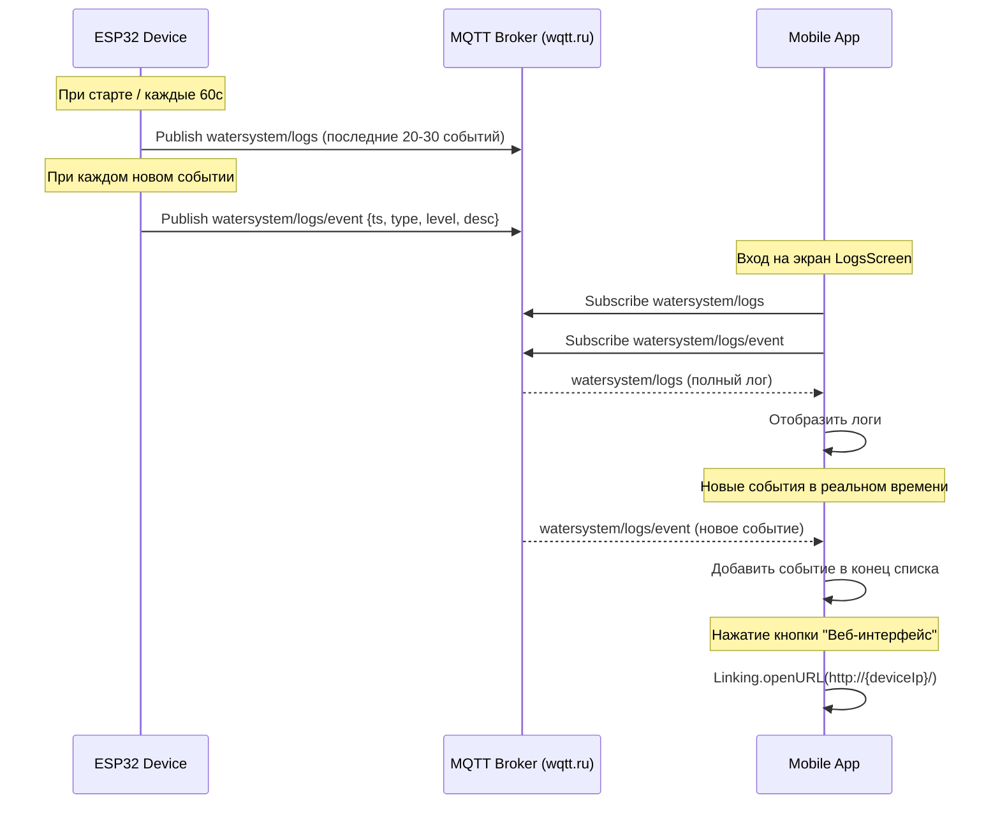

# План редизайна экрана логов мобильного приложения

## Цель
Упростить экран логов: оставить только работающие функции, убрать неработающие режимы, реализовать получение последних 30 событий при входе и подписку на новые события в реальном времени.

## Текущая архитектура (как есть)

### ESP32 (устройство)
- **Топик `watersystem/logs`** — публикуется раз в 60 секунд, содержит последние ~20 записей (обрезано до 2000 байт) в текстовом формате
- **Топик `watersystem/logs/event`** — публикуется при каждом новом событии, JSON: `{ts, type, level, desc}`
- При подключении к MQTT брокеру сразу публикует логи (`vqtt_publishLogs()`)

### Мобильное приложение (сейчас)
- `LogsScreen.tsx` — 4 режима: MQTT, WebView, RAM (direct), SD (direct)
- `DashboardScreen.tsx` — показывает ID устройства и IP
- `MqttService` — подписка на `watersystem/logs` и `watersystem/logs/event`

## Проблемы текущей реализации
1. Режимы RAM и SD требуют прямого HTTP-доступа к ESP32 в локальной сети — часто не работают
2. WebView требует ручного ввода IP — неудобно
3. Нет автоматического получения последних событий при входе на экран
4. Слишком много выбора для пользователя

## Предлагаемые изменения

### 1. LogsScreen.tsx — полное упрощение

**Удалить:**
- `LogSource` типы `direct_events` и `direct_sd`
- `SegmentedButtons` с выбором источника
- Ручной ввод IP (`TextInput` + `openWebInterface`)
- `fetchLogs()` и все связанные функции
- `api.fetchDeviceLogsDirect()` — больше не используется
- `connectionMode` — больше не нужен
- Все Chip-индикаторы режимов

**Оставить и доработать:**
- MQTT режим как единственный основной режим получения логов
- WebView — только как кнопка "Открыть в браузере" с IP из DashboardScreen

### 2. Новая логика работы экрана логов

```
При входе на экран LogsScreen:
  1. Подключиться к MQTT (если ещё не подключены)
  2. Подписаться на watersystem/logs — получить полный лог (последние события)
  3. Отобразить полученные логи
  4. Подписаться на watersystem/logs/event — новые события
  5. Каждое новое событие добавлять в конец списка
  6. IP устройства взять из глобального состояния/контекста (устанавливается DashboardScreen)
```

**Поток данных:**
```
ESP32 --[MQTT]--> watersystem/logs (каждые 60с, полный срез)
ESP32 --[MQTT]--> watersystem/logs/event (каждое событие, стриминг)
                     |
                     v
              MqttService (mobile)
                     |
                     v
              LogsScreen (отображение)
```

### 3. Получение IP устройства

IP уже отображается на DashboardScreen через MQTT телеметрию (`status.ip`).

**Вариант А (рекомендуемый):** Использовать React Context (уже есть `AppContext.ts`) для хранения IP устройства.
- DashboardScreen сохраняет IP в контекст при получении телеметрии
- LogsScreen читает IP из контекста

**Вариант Б:** Использовать AsyncStorage для сохранения IP.

### 4. Кнопка "Открыть веб-интерфейс"

- Показывать только если IP устройства известен
- Использовать `Linking.openURL()` для открытия в браузере устройства
- Можно добавить проверку: если телефон в той же Wi-Fi сети (по префиксу IP), но это опционально

### 5. Изменения в MqttService

Текущая реализация уже поддерживает оба топика:
- `onLogs(cb)` — подписка на `watersystem/logs`
- `onSingleEvent(cb)` — подписка на `watersystem/logs/event`

Дополнительных изменений не требуется.

## Файлы для изменения

| Файл | Изменения |
|------|-----------|
| `mobile/src/screens/LogsScreen.tsx` | Полный редизайн (см. ниже) |
| `mobile/src/context/AppContext.ts` | Добавить поле `deviceIp` (если используется контекст) |
| `mobile/src/screens/DashboardScreen.tsx` | Сохранять IP в контекст при получении телеметрии |

## Детальный план изменений LogsScreen.tsx

### Импорты (упростить)
```typescript
// Было:
import { WebView } from 'react-native-webview'; // удалить
import api from '../services/api';               // удалить
import MqttService from '../services/mqttService';

// Стало:
import MqttService from '../services/mqttService';
import { useAppContext } from '../context/AppContext'; // если через контекст
```

### Состояние (упростить)
```typescript
// Было:
const [logSource, setLogSource] = useState<LogSource>('mqtt_direct');
const [deviceIp, setDeviceIp] = useState<string | null>(null);
const [connectionMode, setConnectionMode] = useState<'direct' | 'proxy' | 'mqtt' | 'mqtt_direct' | 'web' | null>(null);
const [manualIp, setManualIp] = useState('');
const [webViewUrl, setWebViewUrl] = useState<string | null>(null);
const [webViewLoading, setWebViewLoading] = useState(false);

// Стало:
const [logs, setLogs] = useState<string | null>(null);
const [loading, setLoading] = useState(true);
const [error, setError] = useState<string | null>(null);
const [mqttConnected, setMqttConnected] = useState(false);
```

### useEffect для MQTT (обновить)
```typescript
useEffect(() => {
  setLoading(true);
  setError(null);

  const unsubConn = MqttService.onConnectionChange((connected) => {
    setMqttConnected(connected);
    if (connected) setLoading(false);
  });

  // Получаем полный лог (последние 30 событий)
  const unsubLogs = MqttService.onLogs((logsText) => {
    setLogs(logsText);
    setError(null);
    setLoading(false);
  });

  // Подписываемся на новые события
  const unsubEvent = MqttService.onSingleEvent((event) => {
    setLogs((prev) => {
      const line = `${event.ts} - ${event.desc}\n`;
      return prev ? prev + line : line;
    });
  });

  MqttService.connect().catch((err) => {
    console.warn('[LogsScreen] MQTT connect error', err);
    setLoading(false);
    setError('Не удалось подключиться к MQTT брокеру.');
  });

  return () => {
    unsubLogs?.();
    unsubConn?.();
    unsubEvent?.();
  };
}, []);
```

### Кнопка открытия веб-интерфейса
```typescript
const deviceIp = useAppContext()?.deviceIp; // или из пропсов

const openWebInterface = useCallback(() => {
  if (!deviceIp) {
    Alert.alert('IP не известен', 'IP устройства пока не получен. Дождитесь телеметрии на главном экране.');
    return;
  }
  const url = `http://${deviceIp}/`;
  Linking.openURL(url).catch(() => {
    Alert.alert('Ошибка', 'Не удалось открыть браузер');
  });
}, [deviceIp]);
```

### UI (упростить)
```tsx
return (
  <ScrollView style={styles.container}>
    <Card style={styles.card}>
      <Card.Content>
        <Title>Логи устройства</Title>
        
        {deviceIp && (
          <Chip icon="wifi" style={styles.chip}>
            IP устройства: {deviceIp}
          </Chip>
        )}

        <Chip
          icon={mqttConnected ? 'check-circle' : 'alert'}
          style={[styles.chip, mqttConnected ? styles.chipConnected : styles.chipDisconnected]}
        >
          {mqttConnected ? 'MQTT подключён' : 'MQTT не подключён'}
        </Chip>

        {/* Кнопка открытия веб-интерфейса */}
        <Button
          mode="contained"
          onPress={openWebInterface}
          style={styles.button}
          icon="open-in-new"
          disabled={!deviceIp}
        >
          Открыть веб-интерфейс
        </Button>
      </Card.Content>
    </Card>

    {/* Ошибки */}
    {error && (...)}

    {/* Загрузка */}
    {loading && (...)}

    {/* Логи */}
    {logs && (
      <Card style={styles.card}>
        <Card.Content>
          <View style={styles.logHeader}>
            <Title>События</Title>
            <Text style={styles.logLineCount}>
              {logs.split('\n').length} строк
            </Text>
          </View>
          <ScrollView horizontal style={styles.logScrollH}
            contentContainerStyle={styles.logScrollHContent}>
            <ScrollView style={styles.logScrollV}>
              <Text style={styles.logText} selectable>
                {logs}
              </Text>
            </ScrollView>
          </ScrollView>
        </Card.Content>
      </Card>
    )}
  </ScrollView>
);
```

## Диаграмма потока данных



## Проверка и тестирование

1. Убедиться, что MQTT подключение работает (через wqtt.ru)
2. Проверить, что при входе на экран логов приходят последние события
3. Проверить, что новые события добавляются в реальном времени
4. Проверить кнопку "Открыть веб-интерфейс" — должна открывать браузер с IP устройства
5. Убедиться, что старые неработающие режимы удалены