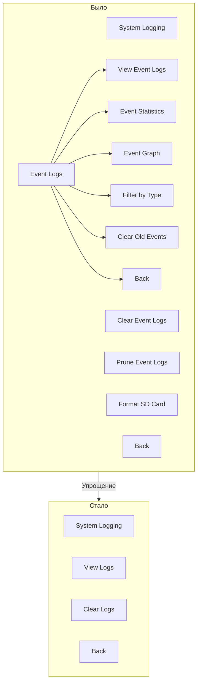

# План упрощения меню "System Logging"

## Текущая проблема

Пункт меню **System Logging** перегружен бесполезными и плохо реализованными функциями:

- **Event Statistics** — примитивная статистика с ASCII-барами на 20-символьном LCD
- **Event Graph** — "график" из символов `#` за 7 дней
- **Filter by Type** — фильтрация с кривым меню выбора типов
- **Clear Old Events** / **Prune Event Logs** — дублируют друг друга (очистка >30 дней)
- **Format SD Card** — не относится к логированию
- Вложенное подменю `Event Logs` → 6 пунктов — избыточно

## Целевая структура (плоская)

После упрощения меню `System Logging` будет содержать **3 пункта**:

```
System Logging
├── View Logs          → EventLogsHandler (просмотр логов через энкодер)
├── Clear Logs         → clearEventLogsMenu (очистка всех логов с подтверждением)
└── Back               → выход
```

## План изменений

### 1. `include/structures.h` — enum MenuItem
Удалить enum-значения, которые больше не используются:
- `mkViewEventLogs = 200`
- `mkEventStats = 201`
- `mkEventGraph = 202`
- `mkFilterByType = 203`
- `mkClearOldEvents = 204`
- `mkPruneEventLogs = 205`
- `mkFormatSdCard = 206`

Оставить:
- `mkSystemLogging = 18` — родительский пункт
- `mkEventLogs = 19` — больше не используется как подменю, но можно оставить для обратной совместимости или удалить
- `mkClearEventLogs = 20` — используется

### 2. `src/menu_data.cpp` — структура меню
Заменить текущую вложенную структуру:
```cpp
// Было:
{ mkEventLogs, mkSystemLogging, "Event Logs", EventLogsHandler },
{ mkClearEventLogs, mkSystemLogging, "Clear Event Logs", clearEventLogsMenu },
{ mkPruneEventLogs, mkSystemLogging, "Prune Event Logs", pruneEventLogsMenu },
{ mkFormatSdCard, mkSystemLogging, "Format SD Card", formatSdMenu },
{ mkBack, mkSystemLogging, "Back", NULL },

// Подменю логов (удалить целиком):
{ mkViewEventLogs, mkEventLogs, "View Event Logs", EventLogsHandler },
{ mkEventStats, mkEventLogs, "Event Statistics", EventStatsHandler },
{ mkEventGraph, mkEventLogs, "Event Graph", EventGraphHandler },
{ mkFilterByType, mkEventLogs, "Filter by Type", EventFilterHandler },
{ mkClearOldEvents, mkEventLogs, "Clear Old Events", clearOldEventsMenu },
{ mkBack, mkEventLogs, "Back", NULL },
```

Стало:
```cpp
{ mkEventLogs, mkSystemLogging, "View Logs", EventLogsHandler },
{ mkClearEventLogs, mkSystemLogging, "Clear Logs", clearEventLogsMenu },
{ mkBack, mkSystemLogging, "Back", NULL },
```

### 3. `src/menu.cpp` — обработчики
Удалить функции-обработчики (или закомментировать, если есть риск, что они где-то ещё используются):
- `EventStatsHandler()` — удалить
- `EventGraphHandler()` — удалить
- `EventFilterHandler()` — удалить
- `clearOldEventsMenu()` — удалить
- `pruneEventLogsMenu()` — удалить
- `formatSdMenu()` — удалить

Оставить:
- `EventLogsHandler()` — просмотр логов
- `clearEventLogsMenu()` — очистка всех логов

### 4. `src/event_logging.cpp` — вспомогательные функции
Удалить функции, которые используются только удалёнными обработчиками:
- `displayEventStats()` — статистика
- `displayEventGraph()` — график
- `showFilterTypeMenu()` — меню выбора фильтра
- `selectEventTypeForFilter()` — выбор типа события
- `selectDateRangeForFilter()` — выбор диапазона дат
- `displayFilteredEvents()` — отображение отфильтрованных

Оставить:
- `eventLogBrowser()` — браузер логов (используется EventLogsHandler)
- `displayEventList()` — отображение записи в списке
- `displayEventDetails()` — детали события
- `getLastEventTime()` — используется в других местах

### 5. `include/menu.h` — объявления
Удалить объявления:
- `void EventStatsHandler();`
- `void EventGraphHandler();`
- `void EventFilterHandler();`
- `void clearOldEventsMenu();`
- `void pruneEventLogsMenu();`
- `void formatSdMenu();`

Оставить:
- `void EventLogsHandler();`
- `void clearEventLogsMenu();`

### 6. `src/display.cpp` — мёртвый код
Удалить функцию `buildStatsMenu()` — она нигде не вызывается.

### 7. Проверка
Убедиться, что:
- Нигде в коде нет ссылок на удалённые enum-значения (`mkEventStats`, `mkEventGraph`, `mkFilterByType`, `mkClearOldEvents`, `mkPruneEventLogs`, `mkFormatSdCard`, `mkViewEventLogs`)
- Компиляция проходит успешно
- Функционал просмотра логов и очистки работает как раньше

## Диаграмма изменений



## Риски
- Никаких, так как удаляемый функционал:
  - Не используется из других мест (проверено поиском)
  - Не влияет на основную логику системы
  - `buildStatsMenu` — мёртвый код (нигде не вызывается)