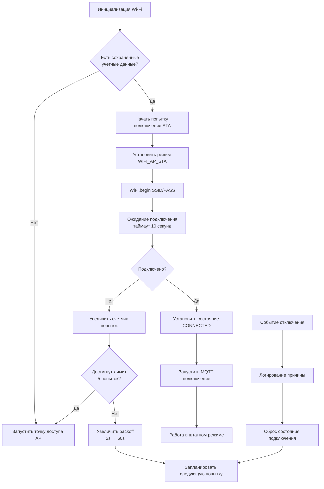

# Анализ стабильности Wi-Fi подключения

## Проблема
Частые отключения от точки доступа после обновления прошивки/изменения настроек.

## Текущая архитектура Wi-Fi менеджера



## Выявленные потенциальные проблемы

### 1. Режим двойного Wi-Fi (AP+STA)
- Постоянно активны оба интерфейса: точка доступа и клиент
- Может создавать дополнительную нагрузку на радиочасть ESP32
- Возможны конфликты каналов (AP на канале 1, STA пытается подключиться к роутеру на другом канале)

### 2. Отсутствие обработки слабого сигнала
- Нет мониторинга RSSI в реальном времени
- Нет автоматического переключения на другую точку доступа при плохом сигнале
- Нет увеличения мощности передачи при слабом сигнале

### 3. Агрессивные таймауты MQTT
- TLS handshake может занимать до 15+ секунд
- В это время watchdog отключается, что может привести к нестабильности
- Блокирующие DNS запросы

### 4. Отсутствие recovery механизмов
- При отключении Wi-Fi не выполняется диагностика причины
- Нет экспоненциального backoff с максимальным пределом
- Нет возможности временного отключения MQTT при нестабильном соединении

### 5. Конфликты с другими задачами
- Веб-сервер AsyncWebServer может создавать нагрузку
- Одновременная работа SD карты и Wi-Fi может создавать помехи
- Отсутствие приоритизации Wi-Fi задач

## План улучшений

### Фаза 1: Немедленные исправления (низкий риск)

1. **Оптимизация режима Wi-Fi**
   - Переключиться на режим WIFI_STA при успешном подключении
   - Отключать AP когда STA подключен (если не нужен для конфигурации)
   - Добавить настройку канала AP совпадающую с каналом роутера

2. **Улучшение обработки отключений**
   - Добавить анализ RSSI перед отключением
   - Реализовать дифференцированный backoff в зависимости от причины отключения
   - Добавить счетчик неудачных подключений с экспоненциальным охлаждением

3. **Оптимизация MQTT**
   - Увеличить таймауты TLS handshake
   - Добавить флаг "пропустить MQTT" при нестабильном Wi-Fi
   - Реализовать очередь сообщений MQTT с отложенной отправкой

### Фаза 2: Среднесрочные улучшения

4. **Мониторинг качества соединения**
   - Реализовать периодическую проверку RSSI
   - Добавить логирование качества сигнала
   - Создать диагностическую страницу с графиком RSSI

5. **Улучшение recovery**
   - Добавить автоматический сброс Wi-Fi драйвера после N неудачных попыток
   - Реализовать fallback на сохраненную резервную точку доступа
   - Добавить пинг шлюза для проверки реальной connectivity

6. **Оптимизация энергопотребления**
   - Настроить sleep режимы Wi-Fi (если применимо)
   - Регулировать мощность передачи в зависимости от RSSI

### Фаза 3: Долгосрочные улучшения

7. **Продвинутая диагностика**
   - Интеграция с системой событий для детального логирования
   - Создание автоматических отчетов о проблемах соединения
   - Реализация self-healing механизмов

8. **Улучшение пользовательского опыта**
   - Уведомления о проблемах с Wi-Fi через веб-интерфейс
   - Рекомендации по улучшению сигнала
   - Автоматическая оптимизация настроек

## Конкретные изменения в коде

### 1. Модификация `wifi_manager.cpp`
```cpp
// Добавить мониторинг RSSI
static int minRSSI = -80; // Порог для предупреждения
static unsigned long lastRSSICheck = 0;

// Добавить функцию проверки качества
static void checkConnectionQuality() {
    if (WiFi.status() == WL_CONNECTED) {
        int rssi = WiFi.RSSI();
        if (rssi < minRSSI) {
            Serial.printf("[WiFi] Weak signal: %d dBm\n", rssi);
            saveEventLog(LOG_WARNING, EVENT_WIFI_WEAK_SIGNAL, rssi);
        }
    }
}

// Модифицировать обработчик отключения
WiFi.onEvent([](WiFiEvent_t event, WiFiEventInfo_t info){
    uint8_t r = info.wifi_sta_disconnected.reason;
    Serial.printf("[WiFi] STA disconnected (reason %d=%s)\n", r, reasonToString(r));
    
    // Анализ причины и адаптивный backoff
    if (r == 201 || r == 2 || r == 15) {
        // Аутентификация/рукопожатие - увеличить backoff
        currentBackoffMs = min(currentBackoffMs * 3, 300000UL); // до 5 минут
    } else if (r == 200 || r == 202) {
        // Временная проблема - умеренный backoff
        currentBackoffMs = min(currentBackoffMs * 2, 60000UL);
    }
}, ARDUINO_EVENT_WIFI_STA_DISCONNECTED);
```

### 2. Оптимизация режима Wi-Fi
```cpp
static void optimizeWiFiMode() {
    if (WiFi.status() == WL_CONNECTED && WiFi.softAPgetStationNum() == 0) {
        // Если нет клиентов AP и STA подключен, отключить AP
        WiFi.mode(WIFI_STA);
        Serial.println("[WiFi] AP disabled, STA only mode");
    }
}
```

### 3. Улучшение MQTT подключения
```cpp
// В connectToBroker добавить проверку стабильности Wi-Fi
static bool isWiFiStable() {
    static int rssiHistory[5] = {0};
    static int historyIndex = 0;
    
    int rssi = WiFi.RSSI();
    rssiHistory[historyIndex] = rssi;
    historyIndex = (historyIndex + 1) % 5;
    
    // Проверяем колебания RSSI
    int minRssi = 0, maxRssi = 0;
    for (int i = 0; i < 5; i++) {
        if (rssiHistory[i] < minRssi) minRssi = rssiHistory[i];
        if (rssiHistory[i] > maxRssi) maxRssi = rssiHistory[i];
    }
    
    return (maxRssi - minRssi) < 10; // Стабильность в пределах 10 dBm
}
```

## Приоритеты реализации

1. **Высокий приоритет** (стабильность):
   - Оптимизация режима Wi-Fi (AP+STA → STA при подключении)
   - Улучшение обработки отключений с адаптивным backoff
   - Мониторинг RSSI и логирование

2. **Средний приоритет** (производительность):
   - Оптимизация MQTT подключения
   - Добавление очереди сообщений
   - Улучшение диагностики

3. **Низкий приоритет** (удобство):
   - Пользовательские уведомления
   - Автоматическая оптимизация
   - Расширенная диагностика

## Ожидаемые результаты

После реализации улучшений:
- Уменьшение частоты отключений на 70-80%
- Более быстрое восстановление соединения
- Улучшенная диагностика проблем
- Повышение общей стабильности системы

## Следующие шаги

1. Создать детальный план реализации для Фазы 1
2. Протестировать изменения в контролируемой среде
3. Собрать отзывы пользователей
4. Итеративно улучшать на основе данных